<p align="center">
  
</p>

<h1 align="center">✝ &nbsp;𝕾𝖆𝖒𝖆𝖊𝖑&nbsp; ✝</h1>

<p align="center">
  
</p>

<p align="center">
  
</p>

<p align="center">
  
  
  
  
</p>
<p align="center">
  
  
  
  
</p>

<h2 align="center">⸸ &nbsp;𝕻𝖊𝖗𝖋𝖎𝖑&nbsp; ⸸</h2>

<p align="center">
  &nbsp; Usuario de Gentoo: <code>USE</code> flags, <code>make.conf</code> y mucha paciencia<br><br>
  
  
  &nbsp; Programación de sistemas en C, C++ y Rust<br><br>
  &nbsp; Me gusta entender cómo funcionan las cosas por dentro<br><br>
  &nbsp; Hablo español
</p>

<p align="center">
  
</p>

<h2 align="center">☩ &nbsp;𝕲𝖗𝖎𝖒𝖔𝖗𝖎𝖔&nbsp; ☩</h2>

<div align="center">

| ☠︎ | |
|:---:|:---|
| ⛧ **Sistema** | &nbsp;Gentoo Linux |
| ⸸ **Lenguajes** | &nbsp;C &nbsp;⛧&nbsp; &nbsp;C++ &nbsp;⛧&nbsp; &nbsp;Rust &nbsp;⛧&nbsp; &nbsp;Bash |
| ☠︎ &nbsp;**Herramientas** | &nbsp;Git &nbsp;⸸&nbsp; &nbsp;Neovim &nbsp;⸸&nbsp; &nbsp;GCC &nbsp;⸸&nbsp; &nbsp;Clang &nbsp;⸸&nbsp; &nbsp;Cargo &nbsp;⸸&nbsp; &nbsp;Make &nbsp;⸸&nbsp; &nbsp;CMake |

</div>

<h2 align="center">✠ &nbsp;𝕽𝖎𝖙𝖚𝖆𝖑&nbsp; ✠</h2>

<p align="center"><i>Cada mañana, el mismo conjuro:</i></p>

```bash
# emerge --ask --verbose --update --deep --newuse @world
```

> ☩ *Memento mori, compila et vive.*

<p align="center">
  
</p>

<h2 align="center">⸸ &nbsp;𝕮𝖔𝖓𝖙𝖆𝖈𝖙𝖔&nbsp; ⸸</h2>

<p align="center">
  <a href="https://github.com/TU_USUARIO"></a>
  <a href="mailto:tu@correo.com"></a>
</p>

<!-- Opcional: estadísticas con colores góticos
<p align="center">
  
</p>
-->

<p align="center">
  
</p>

<p align="center"> ⊱ ─── ⋆⋅ ♰ ⋅⋆ ─── ⊰ </p>
